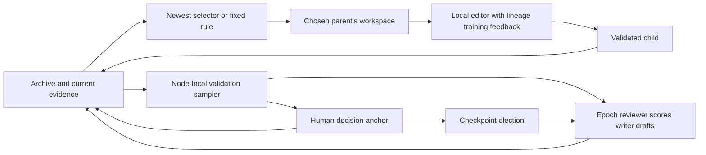

# Editable parent selection in the Red Queen Gödel Machine

Can rewriting the rule for choosing an ancestor produce better paper reviewers than native RQGM subtree Thompson sampling? This study evolves executable writer, reviewer, editor and parent-selector programs around a frozen local Qwen3.5-4B. Human accept/reject decisions anchor the reviewer. The measured outcome is a paired difference in held-out decision accuracy. [Preregistration](reports/preregistration.md) · [Live and published results](https://burnycoder.github.io/red-queen-godel-machine-with-evolvable-parent-selection/) · [Study progress](reports/progress.md)

The most recently admitted workspace chooses a parent. The chosen parent's editor proposes its child. A frozen reviewer scores writer drafts until a stronger human-anchored reviewer wins a checkpoint. Changing reviewers erases earlier reviewer-dependent measurements while preserving human decisions. Native clade sampling, fixed uniform sampling, the HyperAgents handcrafted rule and the initial root provide comparisons. [HyperAgents E.5](https://arxiv.org/pdf/2603.19461v2#page=60) · [October RQGM](https://arxiv.org/html/2606.26294v3#A2.SS4) · [OpenRQGM](https://github.com/DreamFallenFlowers/OpenRQGM/tree/feecb32d9fbdd1c60749ade9ecb47f971e12666e)

## Experiment design

[Exact run matrix](reports/planned-runs.md) · [Literature review](reports/literature-review.md) · [Source and formula audit](reports/state-of-the-art-review.md) · [Plan](reports/plan.md) · [Split fingerprints](results/split-manifest.json)

The pilot compares all four search arms on one seed. Confirmation pairs eight editable/native seeds with two additional controls on the first five. At the first editable midpoint a state swap tests the ongoing effect of executing the learned selector. Fix all test endpoints before sealed scoring. The preregistered primary uncertainty interval resamples both search seeds and shared test papers.

## Reproduction

Use Python 3.12 and uv, Ollama with the registered local model digest, and Ubuntu WSL with bubblewrap (Linux can invoke bubblewrap directly). The package exposes a single study CLI. Large private inputs, full local inference traces and environment credentials stay out of version control. The procedural paper and aggregate tables are regenerated from tracked results.

## Milestones

- [x] Pin publications, upstream implementation and source dataset; register paper-disjoint splits.
- [ ] Ship the CLI, run its tests, publish the executable protocol.
- [ ] Run the local pilot and choose the confirmatory budget from throughput.
- [ ] Freeze and score all confirmatory endpoints, publish comparisons and limitations.
